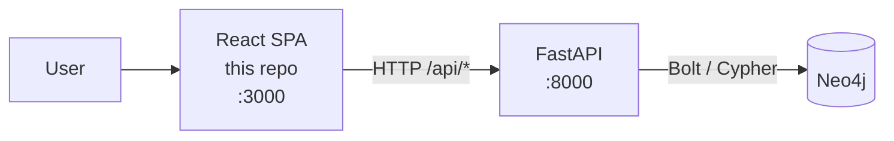

# SkyGraph — Frontend

React single-page application for **SkyGraph**, a system that finds the cheapest
flight route between two airports.

Part of the SkyGraph system:

| Repository                                                                  | Role                          |
| --------------------------------------------------------------------------- | ----------------------------- |
| **SkyGraph-frontend** (this repo)                                           | React single-page application |
| [SkyGraph-backend](https://github.com/ProjetoIntegrador3b/SkyGraph-backend) | FastAPI REST API + Neo4j      |

---

## What the system does

The user picks an **origin** and a **destination** airport plus the travel dates.
The backend searches a graph of airports and flights and returns the **single
cheapest route** for that search.

**Price is the only weight.** The route is chosen by total ticket cost across all
legs — nothing else. The number of connections and the total travel time are shown
alongside the result as information about the chosen route, but they do not
influence which route is selected.

Airports are stored as nodes and flights as relationships in a Neo4j graph
database, which is what makes this a traversal problem rather than a table join.
The architecture is documented in the
[backend README](https://github.com/ProjetoIntegrador3b/SkyGraph-backend#architecture).

### Where this app fits



This repository owns the user interface only: route search input, results
presentation, and client-side navigation. All routing logic and data live behind
the API.

> **Current state:** the app has a single page, `/home`, with the route search.

---

## Tech stack

| Concern    | Choice                     | Notes                                            |
| ---------- | -------------------------- | ------------------------------------------------ |
| Framework  | React 19                   |                                                  |
| Language   | TypeScript 5.9             | Strict mode                                      |
| Build tool | Vite 7                     | Dev server and production bundler                |
| Routing    | React Router 7             | Client-side routing                              |
| Tests      | Vitest 3 + Testing Library | jsdom environment                                |
| Lint       | ESLint 9                   | Flat config, typescript-eslint                   |
| Format     | Prettier 3                 |                                                  |
| Container  | Docker + nginx             | Multi-stage build, static assets served by nginx |

---

## Getting started

```bash
npm install
npm run dev
```

The app is served at **http://localhost:5173**, and `/` redirects to `/home`.

### Available scripts

| Command                | What it does                                     |
| ---------------------- | ------------------------------------------------ |
| `npm run dev`          | Start the Vite dev server with hot reload        |
| `npm run build`        | Type-check and build for production into `dist/` |
| `npm run preview`      | Serve the production build locally               |
| `npm test`             | Run the test suite once                          |
| `npm run test:watch`   | Run tests in watch mode                          |
| `npm run lint`         | Lint with ESLint                                 |
| `npm run typecheck`    | Type-check without emitting                      |
| `npm run format`       | Format all files with Prettier                   |
| `npm run format:check` | Verify formatting without writing                |

---

## Running with Docker

The network is shared with the backend stack, so create it once:

```bash
docker network create skygraph-network
docker compose up -d --build
```

The app is served at **http://localhost:3000**.

The image is a two-stage build: Node compiles the bundle, then nginx serves the
static output — no Node runtime or `node_modules` ship in the final image.

nginx is configured with a single-page-app fallback (`try_files … /index.html`),
which is what allows a hard refresh on `/home` to work instead of returning 404.

To run the whole system, bring up the backend stack as well — both attach to the
same `skygraph-network`.

---

## Project structure

```
src/
├── App.tsx              # Router and route definitions
├── main.tsx             # React root
├── index.css            # Global styles
├── pages/               # One component per route
│   └── Home.tsx         # Route search screen
├── components/          # RouteSearchForm, DateRangePicker, RouteCard
├── services/
│   ├── api.ts           # API address, fetch wrapper, readable error messages
│   ├── airports.ts      # GET /api/airports — airport suggestions
│   ├── routes.ts        # POST /api/routes — cheapest route search
│   └── mockRoutes.ts    # Sample data for mock mode
├── types/               # Airport, Flight and route types, as the API sends them
└── test/
    ├── api.ts           # Fake API responses shared by the tests
    └── setup.ts         # Testing Library setup, runs before each suite
```

Adding a page means creating a component in `src/pages/` and registering a
`<Route>` in `src/App.tsx`.

## Talking to the backend

The route search screen at `/home` uses two endpoints of the
[backend](https://github.com/ProjetoIntegrador3b/SkyGraph-backend#endpoints):

| Request                          | Used for                                                                       |
| -------------------------------- | ------------------------------------------------------------------------------ |
| `GET /api/airports?pageSize=200` | Suggestions in the origin and destination fields, and city names in the result |
| `POST /api/routes`               | The cheapest route for the search                                              |

The search sends the period chosen in the calendar:

```json
{
  "origin": "GRU",
  "destination": "GIG",
  "departureDate": "2027-01-10",
  "returnDate": "2027-01-20"
}
```

The backend answers with the cheapest route that departs and arrives within the
period, or `{"route": null}` when none fits:

```json
{
  "route": {
    "price": 984.95,
    "connections": 1,
    "departureDate": "2027-01-11",
    "arrivalDate": "2027-01-13",
    "legs": [
      {
        "uuid": "…",
        "price": 682.94,
        "origin": "GRU",
        "destination": "FOR",
        "departureDate": "2027-01-11",
        "arrivalDate": "2027-01-11"
      },
      {
        "uuid": "…",
        "price": 302.01,
        "origin": "FOR",
        "destination": "GIG",
        "departureDate": "2027-01-12",
        "arrivalDate": "2027-01-13"
      }
    ]
  }
}
```

If the airport list fails to load, the fields still accept typed codes. API
errors are shown as messages in Portuguese (unknown airport, invalid search, or
server unreachable).

### Which backend the app calls

| How the app runs                  | API address                                                         |
| --------------------------------- | ------------------------------------------------------------------- |
| `npm run dev`                     | `/api`, forwarded by the Vite dev server to `http://localhost:8000` |
| Production build (Vercel, Docker) | `https://skygraph-backend.onrender.com`                             |

Set `VITE_API_URL` to override either, for example in `.env.local`:

```bash
VITE_API_URL=https://skygraph-backend.onrender.com
```

The value is fixed when the app is built, so restart `npm run dev` or rebuild
after changing it. The backend must allow the app's address in its CORS
settings; `localhost:5173`, `localhost:3000` and the Vercel domains already are.

### Local mock data

To work on the UI without any backend, add this to `.env.local`, which Git
ignores:

```bash
VITE_USE_MOCK_API=true
```

The app then returns sample airports and a sample route after a short delay,
without any network request. Restart `npm run dev` after changing it. To use
the backend again, remove the variable or set it to `false`.

---

## Testing

Tests live next to the code they cover as `*.test.tsx` and run in a jsdom
environment through Vitest, which reuses the existing Vite config — there is no
separate test build pipeline.

```bash
npm test
```

---

## Continuous integration

`.github/workflows/ci.yml` runs on every pull request to `main`:

| Check               | Blocks merge?                                              |
| ------------------- | ---------------------------------------------------------- |
| `prettier --check`  | **No** — warns only, annotating the files                  |
| `eslint`            | **Yes**                                                    |
| `tsc` type-check    | **Yes**                                                    |
| `vitest`            | **Yes**                                                    |
| production build    | **Yes**                                                    |
| Docker image builds | **Yes** — builds the image and smoke-tests `/` and `/home` |

Formatting is intentionally advisory: it reports unformatted files as PR
annotations, but never blocks the merge.

`main` is protected — changes land through a pull request with the required checks
passing.
